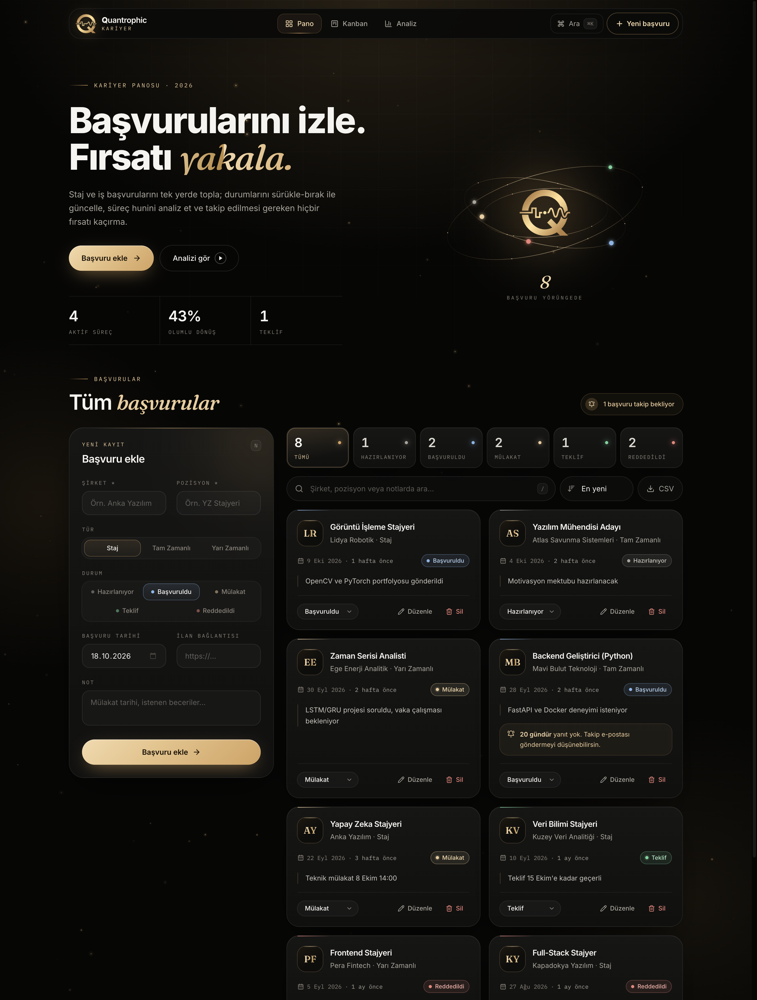

# Başvuru Takip

Staj ve iş başvurularını tek yerden yönetmek için geliştirilmiş bir React uygulaması.
**Software Persona Yapay Zeka Mesleki Gelişim Programı (30. Dönem)**, *Web Geliştirme; Yapay Zeka* proje envanteri kapsamında hazırlandı.

**Canlı demo:** https://basvuru-takip-mmserim.netlify.app



## Özellikler (CRUD)
- **Ekle:** Şirket, pozisyon, tür, durum, tarih, ilan bağlantısı ve not ile yeni başvuru
- **Listele:** Durum kutularıyla filtreleme, metin araması, tarihe göre sıralama
- **Güncelle:** Kart üzerinden hızlı durum değişikliği veya pencerede tüm alanları düzenleme
- **Sil:** Onay penceresiyle güvenli silme
- 14 günden uzun süredir yanıt alınamayan başvurular için takip hatırlatması
- Veriler tarayıcıda **LocalStorage** ile saklanır, sunucu gerekmez

## Teknolojiler
React 19 · Vite · Tailwind CSS 4 · LocalStorage · Netlify

## Klasör yapısı
```
src/
├── components/   # BasvuruFormu, BasvuruKarti, DurumRozeti, IstatistikSeridi, Pencere
├── pages/        # AnaSayfa (CRUD mantığı burada)
├── interfaces/   # Basvuru veri yapısı, durum/tür sabitleri, örnek kayıtlar
└── hooks/        # useLocalStorage
```

## Çalıştırma
```bash
npm install
npm run dev      # geliştirme sunucusu
npm run build    # üretim çıktısı (dist/)
```

Muhammed Mirhan Serim
