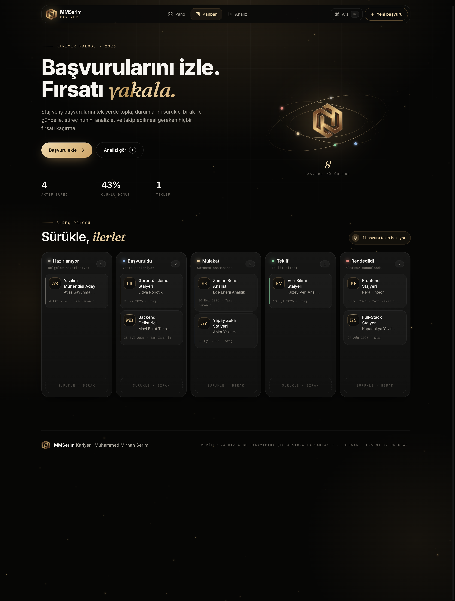
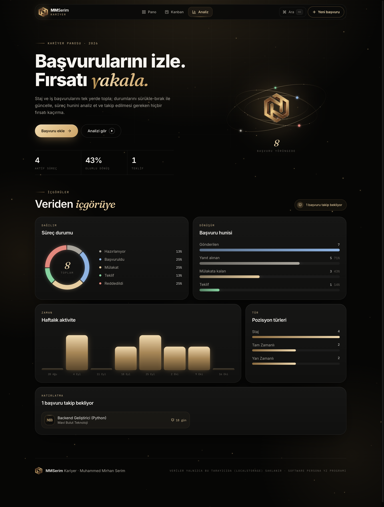

# Başvuru Takip

Staj ve iş başvurularını tek yerden yönetmek için geliştirilmiş bir React uygulaması.
**Software Persona Yapay Zeka Mesleki Gelişim Programı (30. Dönem)**, *Web Geliştirme; Yapay Zeka* proje envanteri kapsamında hazırlandı.

**Canlı demo:** https://basvuru-takip-mmserim.netlify.app


## Özellikler

### CRUD (proje gereksinimi)
- **Ekle:** Şirket, pozisyon, tür, durum, tarih, ilan bağlantısı ve not ile yeni başvuru (form doğrulamalı)
- **Listele:** Durum filtreleri, anlık metin araması, tarih / şirket adına göre sıralama
- **Güncelle:** Kart üzerinden hızlı durum değişikliği, düzenleme penceresi veya Kanban'da sürükle-bırak
- **Sil:** Onay penceresi + birkaç saniyelik **"Geri al"** bildirimi
- Veriler tarayıcıda **LocalStorage** ile kalıcı olarak saklanır, sunucu gerekmez

### Üç görünüm
| Pano | Kanban | Analiz |
|---|---|---|
| Form + filtrelenebilir kart listesi | 5 sütunlu süreç panosu, sürükle-bırak ile durum değiştirme | Halka grafik, dönüşüm hunisi, haftalık aktivite, pozisyon türleri, takip listesi |




### Deneyim
- **MMSerim marka kimliği:** gece siyahı + şampanya altını palet, Inter / Fraunces / IBM Plex Mono
- **Animasyonlar (Motion):** kelime kelime açılan başlık, logo etrafında başvuru durumlarını gösteren yörünge, fareye tepki veren altın toz parçacıkları (canvas), kart hover'ında dönen altın kenar ışını ve imleç ışığı, yay fiziğiyle kayan sekmeler/filtreler, sayan göstergeler, "Teklif" durumunda konfeti
- **⌘K komut paleti:** başvurular ve eylemler arasında klavyeyle arama
- **Klavye kısayolları:** `N` yeni başvuru · `/` arama · `1` `2` `3` görünümler · `Esc` pencereyi kapat
- **CSV dışa aktarma** (Excel'de Türkçe karakterler doğru açılır)
- 14 günden uzun süredir yanıt alınamayan başvurular için takip hatırlatması
- Mobil uyumlu; sistemde "hareketi azalt" açıksa animasyonlar otomatik sadeleşir

## Teknolojiler
React 19 · Vite · Tailwind CSS 4 · Motion · Lucide · LocalStorage · Netlify

## Klasör yapısı
```
src/
├── components/   # BasvuruFormu, BasvuruKarti, KanbanPano, AnalizPaneli, KomutPaleti,
│                 # UstMenu, GorunumSekmeleri, Yorunge, Arkaplan, Pencere, Bildirimler, ...
├── pages/        # AnaSayfa (CRUD mantığı ve görünüm yönetimi)
├── interfaces/   # Basvuru veri yapısı, durum/tür sabitleri, yardımcılar, örnek kayıtlar
├── hooks/        # useLocalStorage, useKisayollar
└── utils/        # CSV dışa aktarma, konfeti üretimi
```

## Çalıştırma
```bash
npm install
npm run dev      # geliştirme sunucusu
npm run build    # üretim çıktısı (dist/)
```

Muhammed Mirhan Serim
